# AVA Tapper

[](https://github.com/Harlock123/AVATapper/actions/workflows/build.yml)

A soda-fountain serving game in the style of Bally Midway's 1983 arcade game **Tapper**, built with
.NET 10 and Avalonia UI. Four bars, one tap at the end of each, and a crowd of thirsty customers
shuffling up them. Pour a fizz, slide it down the bar, catch the empties as they come sliding back,
and don't let anyone reach your tap. Between levels, the Fizz Bandit shakes up the cans.

## Features

- **Four venues**, in turn, each with its own regulars:
  - **The Dusty Spur:** a western saloon with swing doors, cowboy hats and moustaches.
  - **Halftime Grill:** a sports bar with pennants, caps and face paint.
  - **The Neon Cellar:** a basement club with brick walls, neon signs, mohawks and shades.
  - **The Orbit Lounge:** a space bar with stars outside, and aliens with antennae and the odd third eye.
- **Serving**:
  - **Pouring:** hold the pour button at a tap until the mug is full, then let go to send it sliding down the bar. Let go too soon and nothing goes.
  - **Customers:** the first one a mug reaches catches it and is pushed back down the bar. One near the door is pushed out of it.
  - **Empties:** the rest drink up and slide the empty back. Catch it anywhere along the bar.
  - **Moving:** up and down run between the four taps (round from the bottom to the top), and left and right walk the bar.
- **Three ways to lose a bartender**: a full mug falling off the far end with nobody to catch it, an empty smashing at your end, or a customer reaching your tap.
- **Tips**: customers sometimes leave coins on the bar. Pick them up for 1,500 points; they start the jukebox, and everyone stops to dance for a few seconds.
- **The Fizz Bandit**, between levels:
  - he shakes five of six cans of fizz and shuffles them round, faster every level
  - pick the one he didn't shake for 3,000 points
  - pick a shaken one and it sprays in your face
- **Each level** brings a bigger crowd that walks faster and sends the empties back quicker. You get an extra bartender at 20,000 points and every 40,000 after.
- **Sound**: an original honky-tonk rag, and sounds for the pour, the slide, catches, clinks, smashes, the doors, tips, the jukebox, and the bandit's shaking and spraying. All mixed by OpenAL.
- **Attract mode**: leave the title alone for 15 seconds and a computer bartender serves. It:
  - runs to catch empties before they reach the end
  - pours only for customers still waiting, so no mug falls off
  - picks up tips when it's quiet
  - usually spots the right can
- **A top-ten high-score table** with arcade-style initials entry; it records the level reached.
- **Gamepads** through SDL2, as well as the keyboard.
- **Any window size**: the screen scales to fit, letterboxed. **Ctrl+S** saves a screenshot.
- **One self-contained executable** per platform: Windows, macOS and Linux on Intel/AMD and ARM.

## Screenshots

| The title | Level one | The Dusty Spur |
|:---------:|:---------:|:--------------:|
| 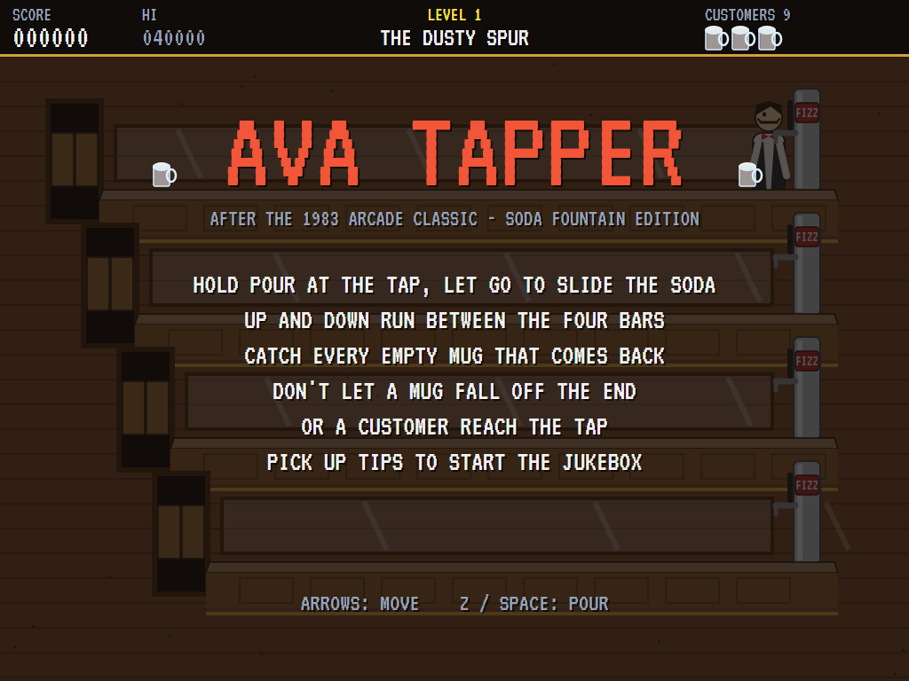 | 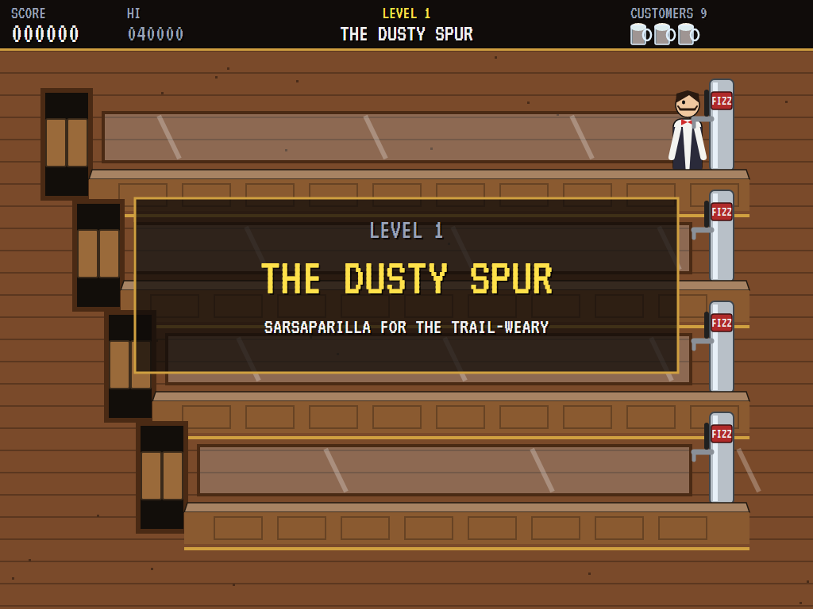 | 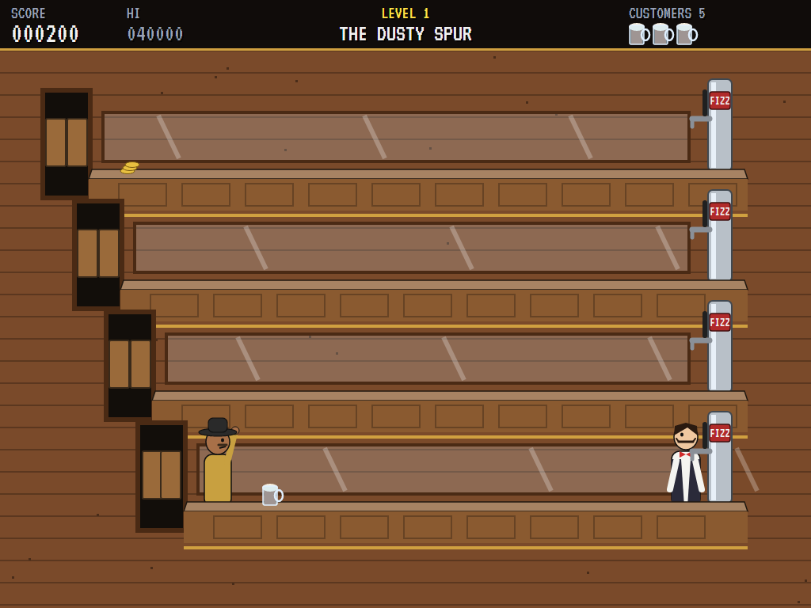 |
| How to serve. | Into the saloon. | Pouring, while a customer bangs on the bar. |

| A tip | The Fizz Bandit | The shuffle |
|:-----:|:---------------:|:-----------:|
| 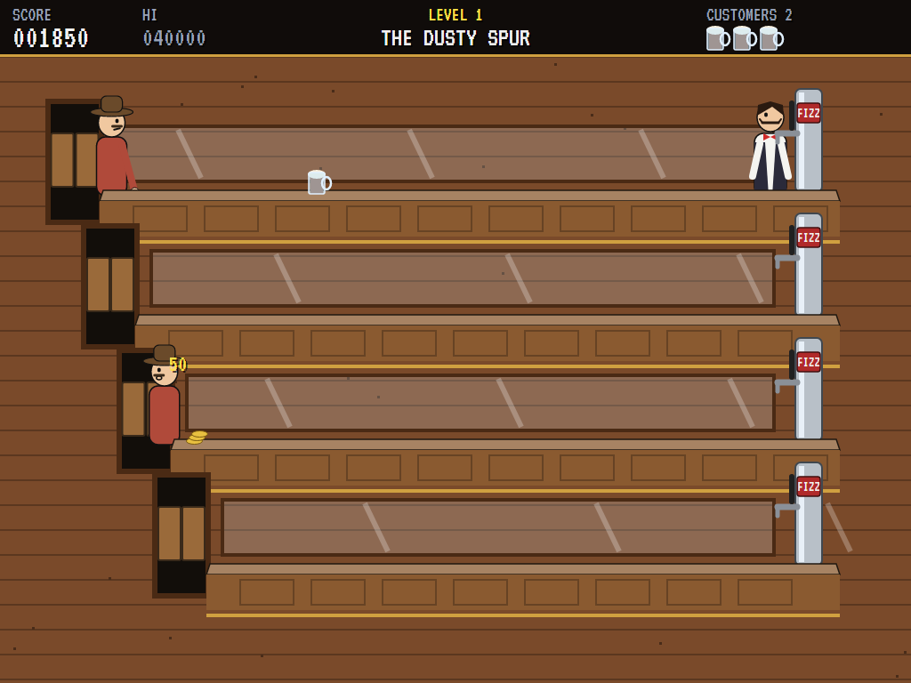 | 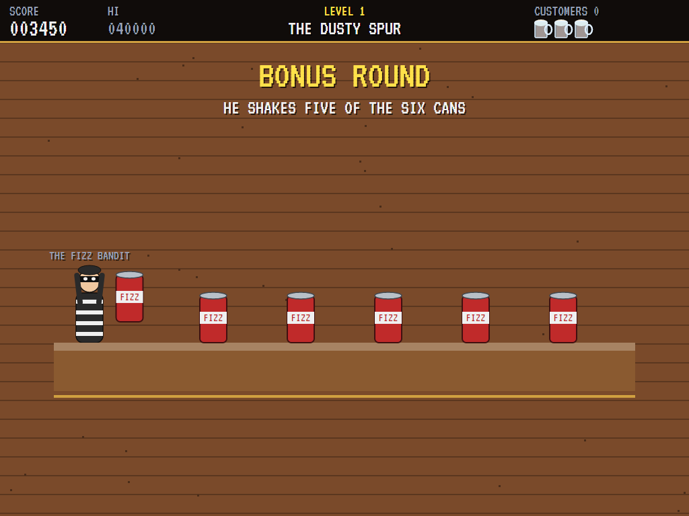 | 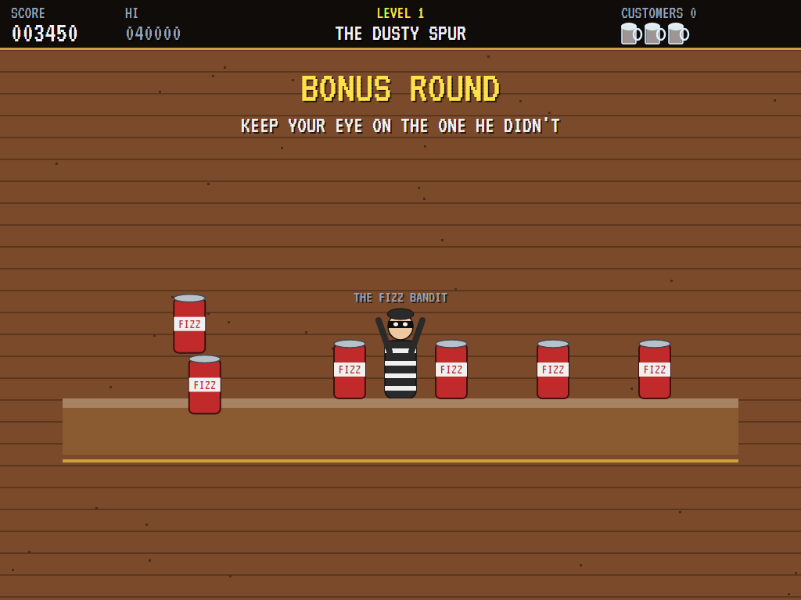 |
| Coins on the bar, and a customer pushed out of the door. | Shaking five of the six. | Keep your eye on the one he didn't. |

| Halftime Grill | The jukebox | The Neon Cellar |
|:--------------:|:-----------:|:---------------:|
| 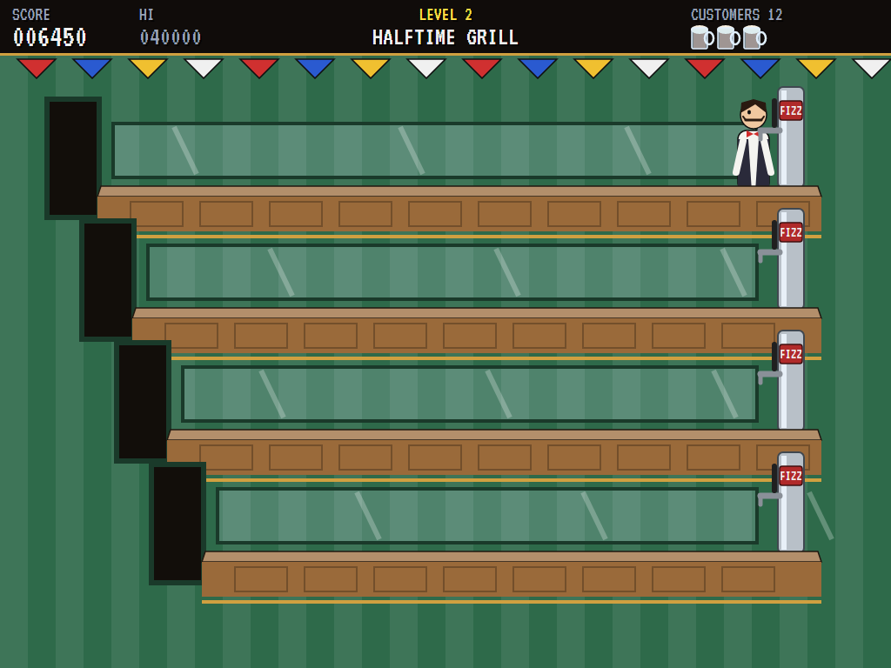 | 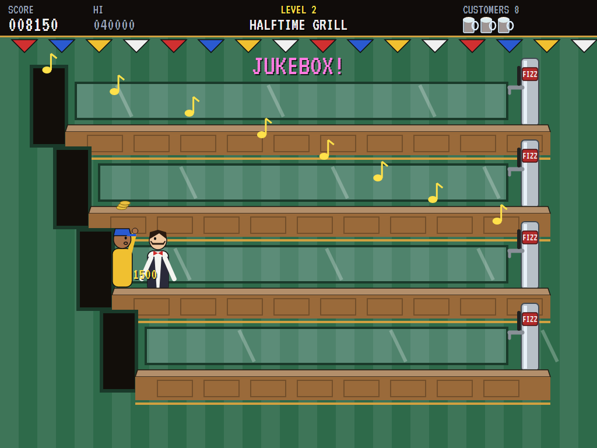 | 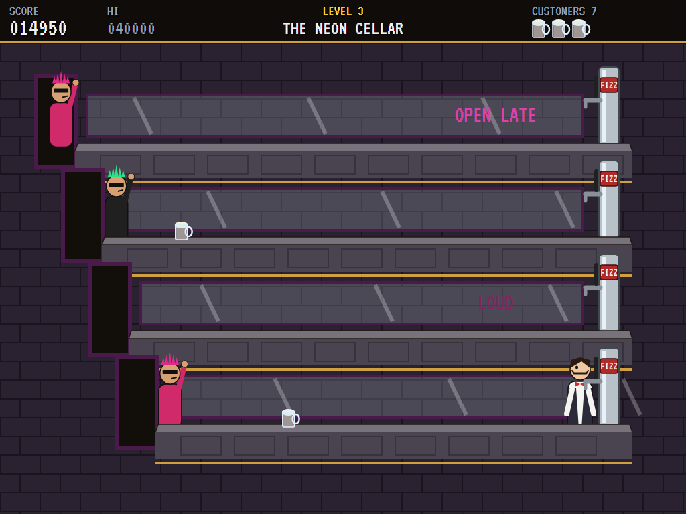 |
| Fans in caps and face paint. | A tip picked up: everyone dances. | Mohawks and shades. |

| The Orbit Lounge | A smash | The best bartenders |
|:----------------:|:-------:|:-------------------:|
| 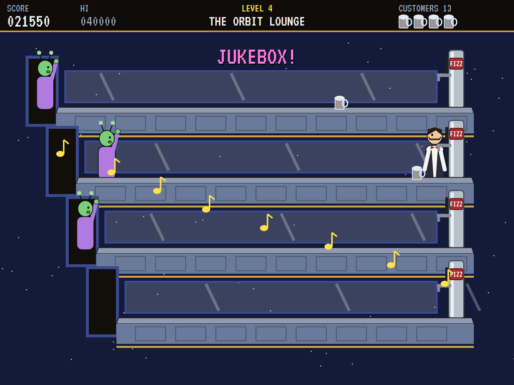 | 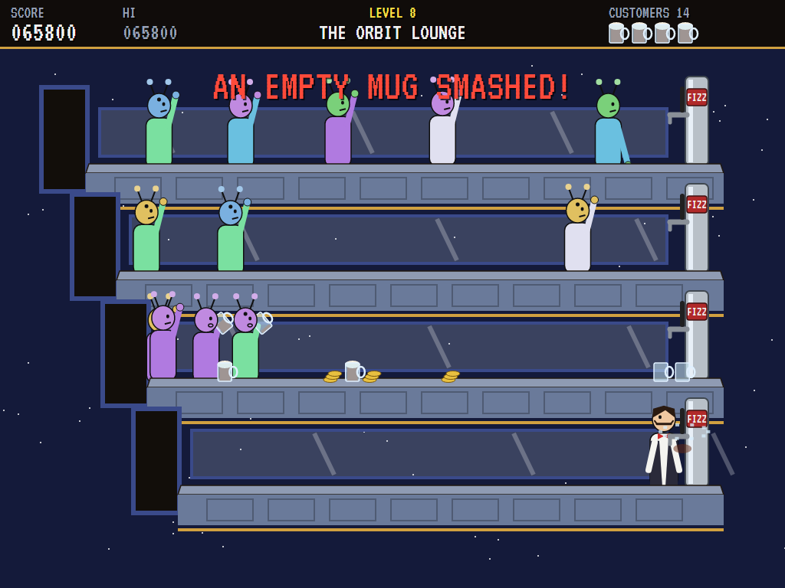 | 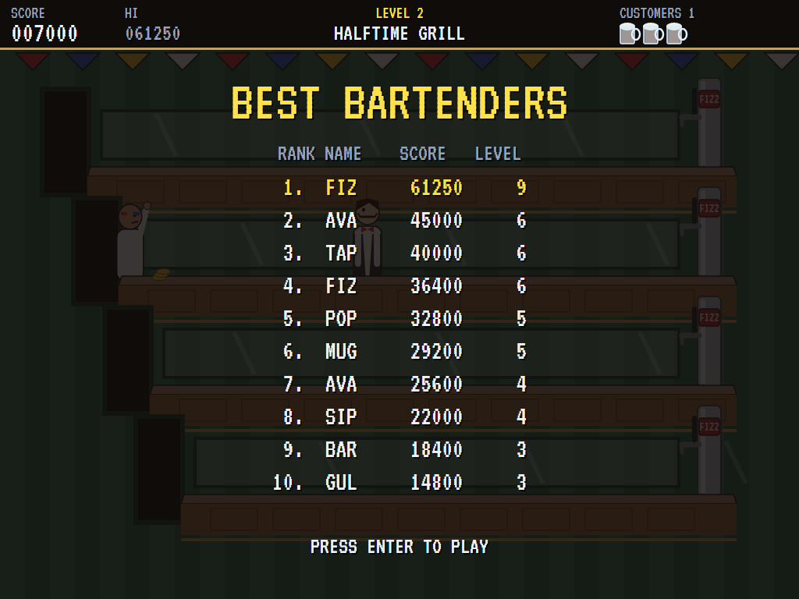 |
| Aliens at the bar. | Level 8: the crowd wins. | The high-score table. |

The screenshots are made by the tests, which play the game in a real (headless) window; see
[Tests](#tests).

## Download and run

Ready-to-run builds for Windows, macOS and Linux, on both Intel/AMD and ARM, are on the
[Releases page](https://github.com/Harlock123/AVATapper/releases/tag/latest). **Latest build** is
rebuilt on every push to `main`. Each download is one self-contained executable: no .NET install is
needed.

| Platform | Archive |
|---|---|
| Windows | `AVATapper-win-x64.zip`, `AVATapper-win-x86.zip`, `AVATapper-win-arm64.zip` |
| macOS | `AVATapper-osx-arm64.tar.gz` (Apple silicon), `AVATapper-osx-x64.tar.gz` (Intel) |
| Linux | `AVATapper-linux-x64.tar.gz`, `AVATapper-linux-arm64.tar.gz`, `AVATapper-linux-arm.tar.gz` |

```bash
tar -xzf AVATapper-linux-x64.tar.gz     # or linux-arm64, linux-arm, osx-arm64, osx-x64
./AVATapper
```

On Windows, unzip and run `AVATapper.exe`. On macOS, if Gatekeeper refuses to open it, run
`xattr -d com.apple.quarantine AVATapper` once. Run with `--no-audio` for silence.

**Sound** comes through OpenAL Soft, built in for every platform. In a virtual machine the game
detects it and uses a larger audio buffer, so the sound doesn't break up.

**Gamepads** use SDL2, which is bundled for Windows, macOS and Intel/AMD Linux. ARM Linux builds need it
installed; without it the keyboard still works:

```bash
sudo apt install libsdl2-dev            # Debian / Ubuntu / Raspberry Pi OS
sudo pacman -S --needed sdl2-compat     # Arch / Omarchy
```

## Controls

| Input | Action |
|-------|--------|
| **Enter** / **Space** | Start |
| **Up** / **Down** (or **W** / **S**) | Run to the tap above or below |
| **Left** / **Right** (or **A** / **D**) | Walk along the bar |
| **Z** / **X** / **Space** / **Ctrl** (hold, then let go) | Pour, then slide the mug |
| **P** / **Esc** | Pause (Esc again to quit) |
| **M** | Mute |
| **Ctrl+S** / **Cmd+S** | Save a screenshot to the Pictures folder |

In the bonus round, **Left** / **Right** choose a can and the pour button opens it.

**Gamepad**: left stick or D-pad to move, **A** or **B** to pour, **Start** to start and pause,
**Back** (while paused) to quit.

**Entering initials**: type letters, or dial with **Up**/**Down** and accept with **Space**; **Left** /
**Backspace** go back; **Enter** finishes.

## Scoring

| What | Points |
|---|---:|
| A customer pushed out of the door | 50 |
| An empty caught | 100 |
| A tip picked up | 1,500 |
| The right can in the bonus round | 3,000 |
| Extra bartender | at 20,000, then every 40,000 |

## Tests

```bash
dotnet test AVATapper.slnx
```

The engine has no UI and runs in fixed 60 Hz steps, so it plays the same at any frame rate, and a seed
always plays the same game. The tests check:

- **The bartender:** running between taps (and round), walking the bar, pouring (and letting go too soon), and no pouring away from the tap.
- **Customers:**
  - catching, being pushed back, drinking and sending the empty back
  - being pushed out of the door
  - the first one down the bar taking the mug
  - queueing rather than passing
- **Mistakes:** a mug falling off the end, an empty smashing, a customer reaching the tap, the bar cleared after a mistake, and running out of bartenders.
- **Tips and levels:** a tip and the jukebox, clearing a level into the bonus round, and the crowd growing and speeding up.
- **The bonus round:** the right can scoring, a wrong one spraying, and the shuffle keeping every can (with all but one shaken).
- **The machine:** the computer bartender clearing the first levels, extra bartenders, the attract mode, initials, the same game from the same seed, and the high-score file.

The screenshot tests draw the real screen in a headless window. To refresh the README's pictures:

```bash
TAPPER_SHOTS=$PWD/Images dotnet test tests/AVATapper.Tests --filter ScreenshotTests
```

To see how the computer bartender gets on (for tuning):

```bash
TAPPER_PROBE=1 dotnet test tests/AVATapper.Tests --filter TapperProbe --logger "console;verbosity=detailed"
```

## Building

```bash
dotnet build AVATapper.slnx
dotnet run --project src/AVATapper
```

Needs the .NET 10 SDK. The sounds are made by `tools/make_sounds.py` (standard-library Python):
`python3 tools/make_sounds.py` rewrites `src/AVATapper/Sounds`.

## Project structure

```
AVATapper/
├── AVATapper.slnx
├── src/AVATapper/
│   ├── Engine/
│   │   ├── GameEngine.cs        # States, the title and demo cycle, and the music
│   │   ├── GameEngine.Play.cs   # The bartender, customers, mugs full and empty, tips and the
│   │   │                        # jukebox, mistakes, levels and extra bartenders
│   │   ├── GameEngine.Bonus.cs  # The Fizz Bandit's bonus round
│   │   ├── BarkeepBrain.cs      # The computer bartender, for the demonstration (and the tests)
│   │   ├── Entities.cs          # The bars, people, mugs, and the four venues
│   │   ├── HighScoreTable.cs, InitialsEntry.cs
│   │   ├── InputHandler.cs, ControllerManager.cs  # Keys and an SDL2 gamepad
│   │   └── SoundManager.cs      # Effects, the serving music and the tunes through OpenAL
│   ├── Audio/                   # The OpenAL engine (from the author's AVABand)
│   ├── Views/                   # The venues, the counters and taps, customers, the bartender,
│   │                            # the bonus round and the screens
│   └── Sounds/                  # The synthesised effects and tunes
├── tests/AVATapper.Tests/       # Gameplay, screenshot and probe tests
├── tools/make_sounds.py
└── Images/                      # Screenshots
```

## About and licence

AVA Tapper © 2026 Lonnie Watson, under the [MIT License](LICENSE).

*Tapper* © 1983 Bally Midway; the name belongs to its current owner. AVA Tapper is an independent,
unofficial game in its style. Its venues, customers, drinks, the Fizz Bandit, graphics, sounds,
tunes and code are its own; nothing is taken from the arcade machine's program, graphics, sound or
music, and it carries no drinks brand. It is not affiliated with or endorsed by any rights holder.
